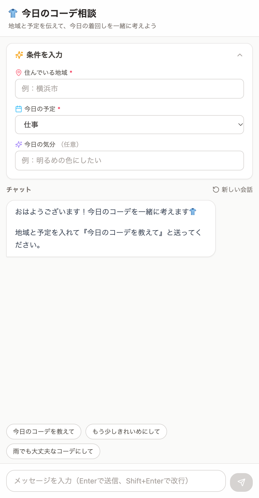
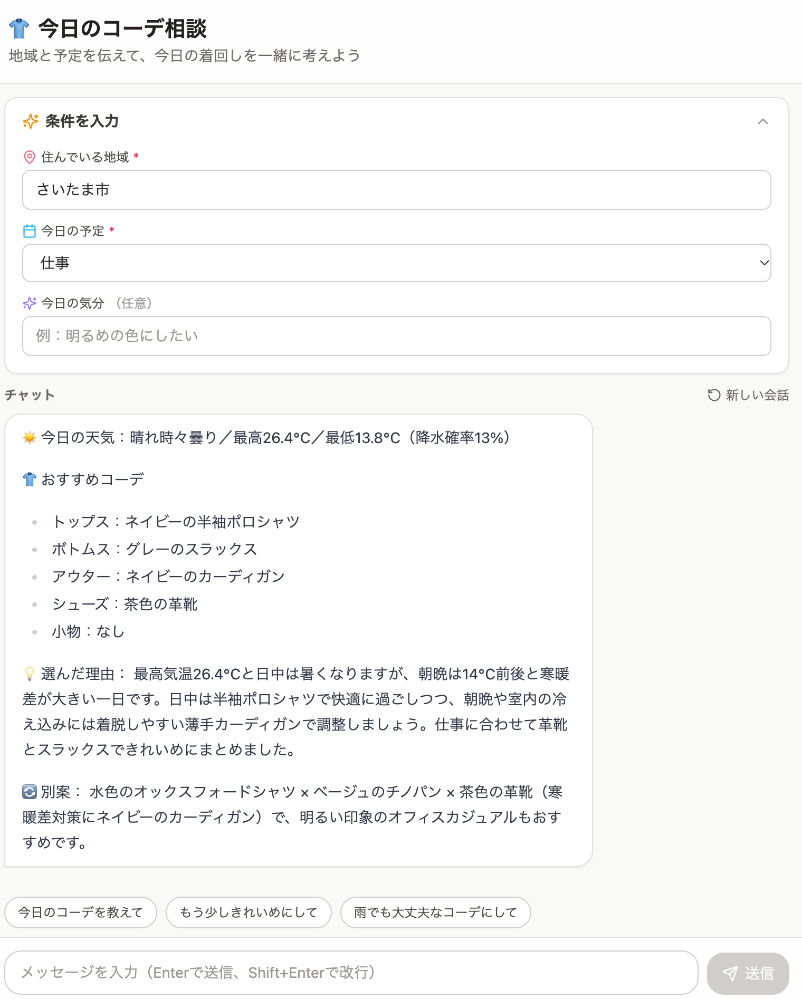
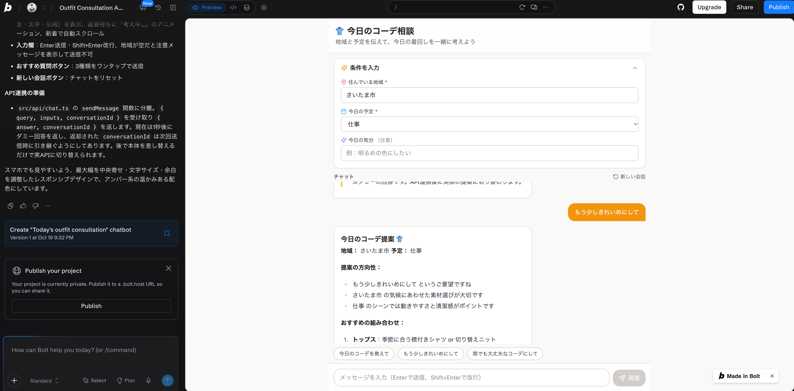
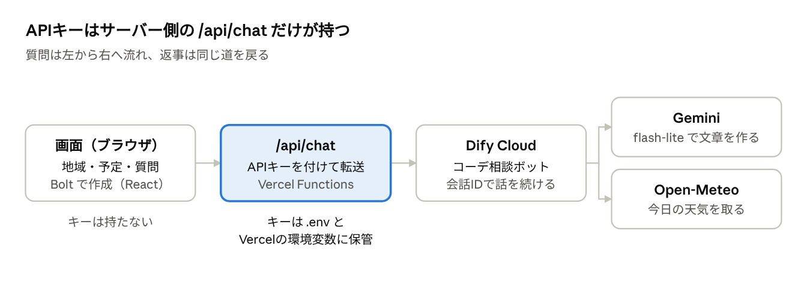

# [課題提出] Difyチャットボット×API連携のWebアプリの実装課題を完成させました

> 提出用の本体は Claude Docs のドキュメントです：https://claude.ai/code/artifact/d098394d-70ef-4cd3-8fec-1e995d99635b
> このファイルは同じ内容の控えです（`zsh copy_article.sh` で画像ごとコピーできます）。

## A. 課題概要

### 課題情報

- 課題名：Difyで作成したチャットボットとAPI連携して、チャットボットwebアプリを作成しよう
- 難易度：★★★☆☆（5段階で自己評価）

### 課題要件

- Boltでチャット画面を作成し、Cursorに移ってDifyのチャットボットとAPI連携する
- AIチャットボット機能があるWebアプリとして、ネット上で使える状態にする
- 使ったボット：前回の課題でDifyに作った「今日のコーデ相談」（地域と今日の予定を伝えると、天気と手持ちの服からコーデを提案する）

### ソースコード

- GitHub：https://github.com/Usuke3122378/outfit-chat
- Google Drive：なし
- 公開URL：https://outfit-chat.vercel.app/

### 成果物のスクリーンショット

メイン画面（公開版をスマホ幅で表示）

実行結果（さいたま市・仕事で「今日のコーデを教えて」と送った結果）

Boltで画面を作った直後（この時点では返事はダミー）

## B. 実装内容

### 使用技術

- 言語：TypeScript（画面）、JavaScript（APIキーを付けて中継するサーバー処理）
- フレームワーク：React、Vite、Tailwind CSS
- データベース：なし（会話の続きは、Difyが会話IDごとに覚えている）
- その他ツール：Bolt.new（画面作成）、Cursor（API連携の実装）、Dify Cloud（チャットボット本体。モデルは Gemini flash-lite、天気は Open-Meteo）、Vercel（公開とサーバー処理）、GitHub（コード保管。push すると Vercel が自動で公開し直す）、react-markdown（返事の見出し・箇条書きを整えて表示）

### 実装した機能

1. 条件入力：住んでいる地域（必須）、今日の予定（5択・必須）、今日の気分（任意）。折りたためる
2. チャット：送信するとDifyのボットが、その日の天気をふまえてコーデを提案する
3. 会話の続き：「もう少しきれいめにして」など、前の提案をふまえて返事をする
4. おすすめ質問ボタン：「今日のコーデを教えて」など3つをワンタップで送信
5. 新しい会話ボタン：チャットを最初からやり直す
6. 返事待ちの「考え中…」表示と、新しいメッセージへの自動スクロール
7. エラー表示：返事をもらえなかったときは、理由つきでチャット内にお知らせを出す

### 工夫したポイント

- 環境変数でAPIキーを管理（セキュリティ対策）：画面は同じサイトの /api/chat にだけ話しかけ、APIキーはサーバー側の /api/chat が付けて Dify に送ります。キーは自分のMacでは .env、公開版では Vercel の環境変数に置き、GitHubには上げていません。名前に VITE_ を付けないことで、画面側のコードに混ざらないようにしました。
- 画面づくりとAPI連携を分けた：Boltには「返事を取る処理は src/api/chat.ts に分けて、今はダミーでよい」と頼みました。Cursorではそのファイルを書き換えるだけで本物につながりました。
- 予定の値を日本語に変換：Boltの画面は予定を work などの英語で持っていて、Difyは「仕事」などの日本語しか受け付けないため、送る前に変換しています。
- 条件を変えたら新しい会話にする：Difyは会話の途中で地域や予定を変えても反映しないので、条件を変えたら会話IDをリセットし、画面にもお知らせを出します。
- エラーハンドリング：通信の失敗やDifyのエラーを日本語のメッセージにして、チャット内に表示します。
- 軽いモデルで安定性を向上：混雑エラー（503）が何度か出たため、Difyの2つのLLMブロックを flash-lite に変えました。返事も速くなりました。

## C. 実装過程

### 開発の流れ

#### 10月19日（1）Boltで画面を作り、GitHubに送る

やったこと：Difyの「APIアクセス」でAPIキーを発行。Boltに指示文を1回送って画面を作成（返事はダミー）。BoltのGitHubボタンからリポジトリ outfit-chat を作成した。

遭遇したエラー：`リポジトリはできたが中身が空。Boltからは push できないと言われた`

Cursorに聞いた内容：（Cursorに移る前なので、Claude Code に相談）「Boltでは push できないと言われました。GitHubのこの画面からできる？」

Cursorの回答：（Claude Code の回答）GitHubの画面からもアップロードはできるが、フォルダの構造が崩れやすい。BoltからZIPでダウンロードして、Macから push するほうが確実。

実際に試したこと：

1. Boltのメニューから「Export → Download」でZIPを保存し、~/Projects/outfit-chat に展開した
    - 結果：.env（APIキー用のファイル）がGitHubに上がらない設定になっていることも確認できた
2. Macから GitHub に push した
    - 結果：GitHubに src や package.json が入った

学んだこと：うまくいかない操作にこだわらず、ZIPのように確実な別の方法に切り替えると早い。

---

#### 10月19日（2）CursorでDify APIと連携する

やったこと：Node.jsを入れ、Cursorでフォルダを開いて npm run dev で画面を表示。CursorのAgentに「/api/chat を通してDify APIにつなぐ。APIキーは .env の DIFY_API_KEY に置き、ブラウザには出さない」と指示文を渡した。

遭遇したエラー：`Access token is invalid`

Cursorに聞いた内容：API連携の指示文を渡し、動作確認まで頼んだ。

Cursorの回答：「いまの .env のキーだと Dify が Access token is invalid を返すので、有効な DIFY_API_KEY に差し替えてください。」

実際に試したこと：

1. .env の中身を確認した
    - 結果：ファイルは作れていたが、保存されておらず空っぽだった
2. キーを書いて ⌘+S で保存し、開発サーバーを起動し直した
    - 結果：Difyから天気入りのコーデ提案が返ってきた

学んだこと：.env を変えたら、保存してから開発サーバーを起動し直す。Cursorのタブに ● が付いているときは未保存。

---

#### 10月19日（3）Geminiの混雑エラー

やったこと：ブラウザで何度か質問を送って動作確認した。

遭遇したエラー：`Run failed: [models] Connection Error, 503 UNAVAILABLE. This model is currently experiencing high demand.`

Cursorに聞いた内容：（Claude Code に相談）「何度か503が返ってきた。Geminiはもう少し軽い lite のような方がいいかも」

Cursorの回答：（Claude Code の回答）503はアプリの不具合ではなく、Gemini側が混み合っているという意味。Difyの「地域名を英語に変換」と「コーデを提案」の2つのブロックで Gemini を使っているので、両方を flash-lite に変えて、Difyの「公開する → 更新」を押す。

実際に試したこと：

1. 時間をおいて同じ質問をもう一度送った
    - 結果：2回目は返事が来た（一時的な混雑だった）
2. Difyで2つのブロックのモデルを flash-lite に変えて、公開を更新した
    - 結果：返事が速くなり、エラーも出にくくなった

学んだこと：APIは「公開済みのバージョン」が呼ばれるので、Difyで設定を変えたら必ず「更新」する。エラーが自分の設定のせいか、相手側の混雑かを見分けると、直す場所がわかる。

---

#### 10月19日（4）Vercelで公開、スマホで文字が変わる

やったこと：VercelでGitHubのリポジトリを読み込み、環境変数に DIFY_API_KEY を入れて公開した（https://outfit-chat.vercel.app/）。

遭遇したエラー：`（エラー表示はなし）スマホで開くと「今日のコーデを教えて」が「今日のコーデを案内する」に変わっていた`

Cursorに聞いた内容：（Claude Code に相談）「スマホ版だと『今日のコーデを案内する』になっている」

Cursorの回答：（Claude Code の回答）ページが英語の設定（lang="en"）でタイトルも英語のままだったので、スマホのブラウザが英語のページと判断して自動翻訳していた。

実際に試したこと：

1. index.html を日本語の設定（lang="ja"）にして、自動翻訳しない設定を追加。タイトルも「今日のコーデ相談」に変えた
    - 結果：GitHubに push すると Vercel が自動で公開し直し、スマホでも正しい日本語で表示された

学んだこと：Boltが作ったページは英語の設定のままのことがある。日本語のアプリなら lang="ja" にしておく。

---

### 参考にした資料

- 公式ドキュメント：Difyアプリの「APIアクセス」ページ（APIキーの発行と、送る内容の説明）
- 参考記事：
- 動画教材：

## D. 学習の振り返り

### 今回学んだこと

技術的な学び：

- APIキーはブラウザに置くと誰でも見られるので、サーバー側（/api/chat）に持たせて中継する
- .env と Vercel の環境変数の役割の違い（自分のMac用と、公開版用）
- Dify API は conversation_id を返すので、次の送信で渡すと会話が続く。予定などの入力は会話の最初にだけ反映される
- GitHubに push すると Vercel が自動で公開し直してくれる

AIツールの使い方：

- エラーメッセージをそのまま貼って聞くと、原因がすぐわかる（Access token is invalid、503 など）
- 指示文に「どのファイルを、どう変えるか」まで書くと一度で通る
- 画面はBolt、API連携はCursorと、得意なことで使い分ける

開発の進め方：

- 先にダミーの返事で画面を完成させてから、本物のAPIにつなぐ
- ローカルで動作確認してから公開すると、問題の切り分けがしやすい

### 作った機能からの発展アイデア

今回作った機能：Dify のチャットボットに、自作のWeb画面からAPIで話しかける機能

発展アイデア：「手持ちの服をアプリの画面から登録・編集して、Difyに一緒に送れるようにする」

### 次の課題に向けて

- 503などの混雑エラーのときに、自動でもう一度送り直す（リトライ）処理を入れたい
- 返事を1文字ずつ表示するストリーミングに挑戦して、待ち時間を短く感じさせたい
- .env の保存忘れのようなミスを防ぐため、キーが空ならサーバー起動時に注意を出すようにしたい

---

📝 追加メモ

- APIキーはGitHubに上げていません（.env は .gitignore に入っています）
- 前回の課題で作ったDifyボット「今日のコーデ相談」をそのまま使っています
